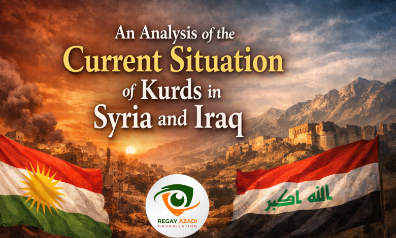

<!DOCTYPE html>
<html lang="ku" dir="rtl">
<head>
<meta charset="UTF-8">
<meta name="viewport" content="width=device-width, initial-scale=1">
<meta name="author" content="Nihad Aras Kareem">
<meta name="description" content="شیکردنەوەی دۆخی ئێستای کورد لە سووریا و عێراق بە سێ زمان.">
<meta property="og:title" content="شیکردنەوەی دۆخی ئێستای کورد لە سووریا و عێراق">
<meta property="og:description" content="شیکردنەوەی سیاسی لەسەر دۆخی کورد لە سووریا و عێراق.">
<title>شیکردنەوەی دۆخی ئێستای کورد لە سووریا و عێراق | Nihad Kareem</title>

</head>
<body>
<header>

NIHAD KAREEM

<button type="button" class="active" data-lang="ku">کوردی</button>
<button type="button" data-lang="en">EN</button>
<button type="button" data-lang="ar">العربية</button>

</header>
<main class="wrap">
<a class="back" href="../index.html">← گەڕانەوە بۆ سەرەکی</a>
<article>

شیکردنەوەی سیاسی

<h1 data-i18n="title">شیکردنەوەی دۆخی ئێستای کورد لە سووریا و عێراق</h1>

نووسەر: نیهاد ئاراس کەریم · ٢١ی کانوونی دووەمی ٢٠٢٦

<section class="article-language current" id="content-ku" lang="ku" dir="rtl">
<h2>کوردیی سۆرانی</h2>
<h2>شیکردنەوەی دۆخی ئێستای کورد لە سووریا و عێراق</h2>

دۆخی ئێستای کورد لە سووریا و عێراق تەنها ئەنجامی گۆڕانکارییە سیاسییە کاتییەکان نییە؛ بەڵکو نیشانەیەکی ڕوونی شکستی ئەو سیستەمانەیە کە لەسەر درۆ، زۆرەملێ و نکۆڵیکردن دامەزراون. وەک نەتەوەیەک، کورد بەهۆی لاوازیی ناوخۆیی نەکەوتووەتە ئەم دۆخە دژوارەوە، بەڵکو بەهۆی نەبوونی دادپەروەری و دروستگۆیی لە بیرکردنەوەی دەوڵەتە دراوسێکانەوەیە. ئەمەش کۆتایی ساڵانی زۆری گوشاری سیستەماتیک و نادادپەروەرییە کە ئێستا گەیشتووەتە ئاستێکی مەترسیدار.

لە سووریا، ملمڵانێکە لەسەر پاراستنی ناسنامەی نەتەوەیی کورد. حکومەتی ناوەندی هێشتا ئامادە نییە کورد وەک پێکهاتەیەکی ڕەسەنی ئەو خاکە و هاوبەشێکی ڕاستەقینە قبووڵ بکات. هێرشەکان بۆ سەر ناوچە کوردییەکان ڕووداوی تاک و جیاواز نین؛ بەڵکو هەوڵێکی سیستەماتیکن بۆ زیندووکردنەوەی ئەو بیرکردنەوەیەی کە ناسنامەی کوردی وەک هەڕەشەیەک دەبینێت.

دیمەشق بە بیانووی «پاراستنی یەکپارچەیی خاک» هەوڵ دەدات هەر جۆرە خۆبەڕێوەبردنێک بسڕێتەوە و کورد بگەڕێنێتەوە بۆ چوارچێوەیەکی ترس، بێدەنگی و بێبەشکردن.

جێی سەرنجە کە ئەم فشارانە لە کاتێکدا ڕوودەدەن کە کورد سەلماندوویەتی هێزێکی سەرەکی بووە لە شکستهێنانی تیرۆریزمدا. بەڵام وەک دیارە، کێشەی دەوڵەتی سووریا کێشەیەکی ئەمنی نییە، بەڵکو ڕەتکردنەوەی داننان بە بوونی سیاسی و کولتووریی کوردە.

لە عێراق، وێنەکە ئاڵۆزتر و نائارامترە، چونکە نەتەوەکە لەنێوان ناکۆکییە ناوەندییەکان و داڕمانی ناوخۆییدا گیرۆدە بووە. بەغدا بەرامبەر هەرێمی کوردستان سیاسەتی «دووانە» پەیڕەو دەکات؛ لە کاتێکدا گوتاری فەرمی باس لە هاوبەشی و دەستوور دەکات، لە کردەوەدا بودجە، مووچە و ژیانی خەڵک دەکرێنە ئامرازی سیاسی بۆ لاوازکردنی پێگەی دەستووریی هەرێم.

هێشتا بیرکردنەوەی سیاسی لە بەغدا ناتوانێت کورد وەک «هاوبەش» ببینێت، بەڵکو وەک «ژێردەستێکی یاخی» مامەڵەی لەگەڵ دەکات.

بەڵام کارەساتە گەورەترەکە لە ناو ماڵی کوردایەتی خۆیدایە.

لە کوردستانی عێراق، گەندەڵی لە خراپەکاریی تاکەکەسییەوە گۆڕاوە بۆ سیستەمێکی جێگیر. دەسەڵات تەرخان کراوە بۆ خزمەتکردنی بنەماڵە و حیزبەکان، لە کاتێکدا یاسا بووەتە ئامرازێک بۆ پاراستنی بەرژەوەندییەکانی کەمینەیەکی دەسەڵاتدار.

ئەم ڕاستییە نەک تەنها سامانی گشتیی بەفیڕۆ داوە، بەڵکو گەنجانی کوردیشی ماندوو کردووە و هیواکانیان بۆ داهاتووی لەناوبردووە.

ئەوەی ڕوودەدات تەنها شکستی بەڕێوەبردن نییە؛ بەڵکو خیانەتێکی قووڵە بە متمانەی خەڵک و خوێنی شەهیدان. مێژوو سەلماندوویەتی هیچ دەسەڵات و دامەزراوەیەک ناتوانێت بەبێ «دادپەروەری» و «دروستگۆیی» بەردەوام بێت. ئەگەر ئەم دۆخە بەردەوام بێت، تەنها پێگەی سیاسی مەترسی لەسەر نابێت، بەڵکو پێکهاتەی کۆمەڵایەتی و هەستی سەر بە نەتەوەبوونیش ڕووبەڕووی مەترسییەکی گەورەی لێکترازانەوە دەبنەوە.

</section>

<section class="article-language" id="content-en" lang="en" dir="ltr">
<h2>English</h2>
<h2>An Analysis of the Current Situation of Kurds in Syria and Iraq</h2>

The current situation of Kurds in Syria and Iraq is not merely the result of temporary political shifts; it is a clear indication of the failure of political systems built on falsehood, coercion, and denial. As a nation, Kurds have fallen into this dire state not because of internal weakness but due to a lack of justice and integrity in the mindset of neighbouring states. This is the culmination of long years of systemic pressure and injustice that has now reached a critical peak.

In Syria, the struggle centres on the preservation of Kurdish national identity. The central government remains unwilling to accept Kurds as an indigenous component and a genuine partner. The attacks on Kurdish regions are not isolated incidents; they are systematic attempts to revive the chauvinistic mentality that views Kurdish identity as a threat.

Under the guise of “protecting territorial integrity,” Damascus seeks to erase any form of self-governance and return Kurds to a framework of fear, silence, and deprivation.

Notably, these pressures occur even though Kurds proved to be a primary force in defeating terrorism. However, as it appears, the Syrian state’s issue is not one of security, but rather a refusal to recognize Kurdish political and cultural existence.

In Iraq, the picture is even more complex and unstable, as the nation is caught between central conflicts and internal collapse. Baghdad pursues a policy of “duality” toward the Kurdistan Region; while official rhetoric speaks of partnership and the constitution, in practice, the budget, salaries, and the livelihood of the people are weaponized as political tools to weaken the region’s constitutional status.

The political mindset in Baghdad still fails to see Kurds as “partners,” treating them instead as a “rebellious subordinate.”

Yet, the greater tragedy lies within the Kurdish house itself.

In Iraqi Kurdistan, corruption has evolved from individual misconduct into a stabilized system. Power has been confined to the service of families and parties, while the law has become a tool to protect the interests of a powerful minority.

This reality has not only squandered public wealth but has also exhausted Kurdish youth and aborted their hope for the future.

What is happening is not merely a failure of governance; it is a profound betrayal of the people’s trust and the blood of the martyrs. History has proven that no entity can endure without “justice” and “integrity.” If this situation continues, it is not only political standing that is at risk, but the very social fabric and national belonging face a dangerous threat of disintegration.

</section>

<section class="article-language" id="content-ar" lang="ar" dir="rtl">
<h2>العربية</h2>
<h2>تحليل الوضع الراهن للكرد في سوريا والعراق</h2>

إن الوضع الراهن للكرد في سوريا والعراق ليس مجرد نتيجة لتحولات سياسية مؤقتة، بل هو مؤشر واضح على فشل الأنظمة السياسية القائمة على الزيف والإكراه والإنكار. وبصفتهم أمة، لم يصل الكرد إلى هذا الوضع الصعب بسبب ضعف داخلي، بل نتيجة غياب العدالة والنزاهة في ذهنية الدول المجاورة. وهذا هو حصيلة سنوات طويلة من الضغوط الممنهجة والظلم الذي بلغ الآن ذروة حرجة.

في سوريا، يتمحور النضال حول الحفاظ على الهوية القومية الكردية. فما زالت الحكومة المركزية غير مستعدة للاعتراف بالكرد بوصفهم مكوّناً أصيلاً وشريكاً حقيقياً. إن الهجمات على المناطق الكردية ليست حوادث منفردة، بل هي محاولات ممنهجة لإحياء العقلية الشوفينية التي تنظر إلى الهوية الكردية باعتبارها تهديداً.

وتحت ذريعة «حماية وحدة الأراضي السورية»، تسعى دمشق إلى إلغاء أي شكل من أشكال الإدارة الذاتية وإعادة الكرد إلى إطار من الخوف والصمت والحرمان.

ومن الجدير بالملاحظة أن هذه الضغوط تحدث رغم أن الكرد أثبتوا أنهم كانوا قوة رئيسية في هزيمة الإرهاب. غير أن مشكلة الدولة السورية، كما يبدو، ليست مشكلة أمنية، بل هي رفض الاعتراف بالوجود السياسي والثقافي للكرد.

أما في العراق، فالصورة أكثر تعقيداً واضطراباً، إذ إن الأمة عالقة بين الصراعات المركزية والانهيار الداخلي. وتنتهج بغداد سياسة «الازدواجية» تجاه إقليم كردستان؛ ففي حين يتحدث الخطاب الرسمي عن الشراكة والدستور، تُستخدم الميزانية والرواتب ومعيشة الناس عملياً أدواتٍ سياسية لإضعاف المكانة الدستورية للإقليم.

ولا تزال العقلية السياسية في بغداد عاجزة عن رؤية الكرد بوصفهم «شركاء»، بل تتعامل معهم باعتبارهم «تابعاً متمرداً».

لكن المأساة الأكبر تكمن داخل البيت الكردي نفسه.

في كردستان العراق، تطور الفساد من ممارسات فردية إلى نظام مستقر. وأصبحت السلطة محصورة في خدمة العائلات والأحزاب، فيما تحول القانون إلى أداة لحماية مصالح أقلية نافذة.

ولم تؤدِّ هذه الحقيقة إلى تبديد الثروة العامة فحسب، بل استنزفت أيضاً طاقات الشباب الكردي وأجهضت آمالهم في المستقبل.

إن ما يحدث ليس مجرد فشل في الحكم والإدارة، بل هو خيانة عميقة لثقة الشعب ودماء الشهداء. وقد أثبت التاريخ أن لا كيان يستطيع الاستمرار من دون «العدالة» و«النزاهة». وإذا استمر هذا الوضع، فلن يكون الموقع السياسي وحده عرضة للخطر، بل إن النسيج الاجتماعي ذاته والانتماء القومي سيواجهان تهديداً خطيراً بالتفكك.

</section>

<strong data-i18n="originalLabel">سەرچاوەی سەرەکی:</strong>
<a href="https://regayazadi-lrj.co.uk/en/an-analysis-of-the-current-situation-of-kurds-in-syria-and-iraq/" target="_blank" rel="noopener noreferrer" data-i18n="originalLink">regayazadi-lrj.co.uk — وتاری سەرەکی</a>

ئامادەکردنی: نیهاد ئاراس کەریم

</article>
</main>
<footer>
NIHAD KAREEM

©  Nihad Aras Kareem
</footer>

</body>
</html>
